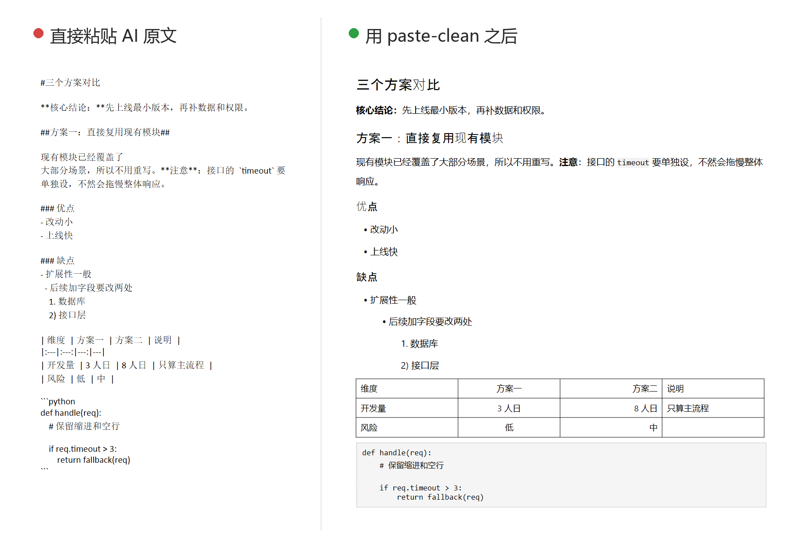

# paste-clean

> 把 AI 输出的原文，变成能直接粘贴的 `.docx`：真标题、真列表、真表格、代码块，不留残留符号。

一个 DeepSeek Harness Skill，也可以单独当命令行工具用。



<sub>左：把 AI 原文直接粘进 Word。右：同一个文件跑一遍 `clean_paste.py`。两张图都是真实渲染，输入是 [`examples/demo_before.md`](examples/demo_before.md)。</sub>

---

## 它解决什么

从聊天窗口把 AI 的答案复制到飞书 / Word / 微信，通常会遇到三类问题：

1. **符号残留**：`**`、`#`、`>`、`|`、零宽字符、满屏空行。
2. **断行错了**：一句话被聊天窗宽度硬折成三行（该连的断成两截），或者两段被粘成一坨（该断的粘一起）。
3. **结构没了**：标题只是一行加粗，表格只剩一堆竖线，粘过去就是纯文本。

`paste-clean` 把这些结构识别出来写进真正的 Word 文档：标题用 Heading 样式、列表有缩进层级、表格是带边框的 Word 表格（表头加粗、跨页重复），代码块是等宽灰底框。打开 docx，全选复制，粘到飞书 / Word 就是对的。

**拿不准的地方一律原样保留。** 宁可少变，不要错变。

---

## 用法

### 当命令行工具

```bash
pip install python-docx                    # 唯一的依赖
python3 scripts/clean_paste.py 原文.md -o out/
```

输出 `原文.clean.docx`。也支持标准输入和 GBK 文件：

```bash
cat 原文.txt | python3 scripts/clean_paste.py - -o out/
```

### 作为 DeepSeek Harness Skill

把整个目录放进去：

```
~/.dsh/skills/paste-clean/
```

DSH 扫描 `<DSH_HOME>/skills` 这个根，下一次目录刷新就能看到（不用重启）。如果放在带 `.git` 的项目里的 `<项目>/.dsh/skills/paste-clean/`，项目级优先于用户级。

`SKILL.md` 开头的 frontmatter 是硬门槛：`name` 必须是 kebab-case，`description` 必填。写错会被静默跳过——模型看不到，也不会报错。

---

## 它认什么

| 输入 | 结果 |
|---|---|
| `# 标题`、`## 标题 ##`、`#标题` | Heading 1/2，收尾井号去掉 |
| `#1 计划` | 普通段落（像话题标签，不当标题） |
| `**整行加粗**` | 加粗段落，**不**提升成标题 |
| `- ` `* ` `+ ` `•` `·` | 项目符号，按缩进分 1~6 层 |
| `1.` `1、` `1)` `1）` | 编号列表，序号照抄原文 |
| `1.5 倍` | 普通文字（不当列表） |
| GFM 表格（表头 + `\|---\|` 分隔行） | 真 Word 表格，`:` 决定左右对齐 |
| 连续 ≥2 行、列数一致的竖线块（缺分隔行） | 也认成表格，第一行当表头 |
| 单独一行带竖线 | 普通文字，竖线保留（不猜） |
| 全角 `｜` 组成的表 | 同样认成表格 |
| ` ``` ` 围栏 | 等宽灰底代码框，围栏和语言标记去掉，缩进原样保留 |
| 没闭合的围栏 | 丢掉那行标记，后面照常当正文（不吞掉整篇） |
| 单独一行 `***` `---` | 分隔线，丢掉 |
| `[文字](链接)` | 真超链接 |
| 上一行没有句末标点 | 和下一行接成一段 |
| 零宽字符、行尾空白、行首全角空格 | 清掉 |

表里没写的，一律原样保留。

---

## 为什么规则写在代码里

如果让模型"看着洗一遍"，同一个输入今天和明天出来的东西就不一样。这里的规则全部在 `scripts/clean_paste.py` 里：可读、可 diff、可以回归。

模型（或人）只做三件事：把原文原样落盘 → 跑一条命令 → 读输出路径。

## 确定性

同样的输入，得到**同样的字节**。

docx 本质是 zip，Python 存盘时会往每个 zip 条目写当前时间。所以最后一步把 zip 重写一遍：条目排序 + 时间戳固定成 `1980-01-01`。

```bash
python3 scripts/clean_paste.py examples/sample_raw.md -o out1
python3 scripts/clean_paste.py examples/sample_raw.md -o out2
sha256sum out1/*.docx out2/*.docx      # 两行必须一致
```

脚本自己也会打印 `sha256:xxxxxxxx`，方便对比。

---

## 代码结构

`scripts/clean_paste.py` 单文件，从上到下 9 段：

| 段 | 内容 |
|---|---|
| 1 常量 | 所有正则、字号、字体、句末标点表 |
| 2 数据模型 | `Block`（heading / para / bullet / number / table / code） |
| 3 行级清洗 | 零宽字符、缩进拆分、断行判定 |
| 4 表格 | 拆单元格、认分隔行、读对齐 |
| 5 行内格式 | `**粗**` `*斜*` `` `码` `` `[文字](链接)` 的手写解析 |
| 6 块解析 | 状态机：这一行到底是什么 |
| 7 渲染 | Block → docx 样式、表格、代码框、超链接 |
| 8 确定性 | zip 重排 + 固定时间戳 |
| 9 入口 | 命令行、编码嗅探、报告输出 |

解析和渲染是分开的：解析器只回答「这一行是什么」，渲染器只回答「这种块长什么样」。想加 `.md` 输出，只写一个新渲染器，解析器一行不用动。

---

## 已知边界

- **微信不支持表格**，平台限制。docx 里的表格粘进微信会退化成正文本；纯文字段落和列表的换行会保留。
- **不认 `（1）`、`第一、`、`一是`** 这类中文序号：和正文指代分不开，当列表会误伤，所以保留成普通段落（文字不丢）。
- **4 空格缩进的代码块不当代码块**：和嵌套列表在语法上无法区分。
- **图片 `` 原样保留**：纯本地、不联网，不下载图片。
- **诗 / 地址 / 名单**这种「每行都短、行尾没标点」的内容会被接成一段；加一个空行可以强制断开。
- **不做首行缩进 2 字符**：粘贴目标通常自己会套版式。

---

## License

MIT
